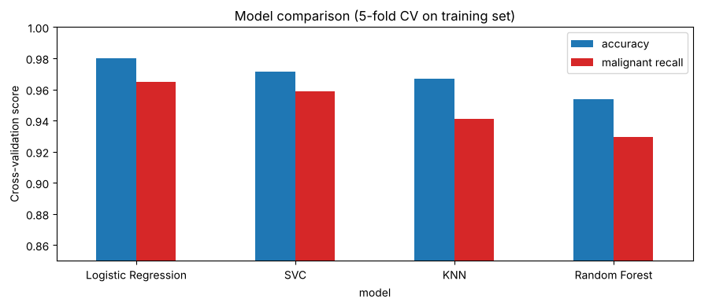
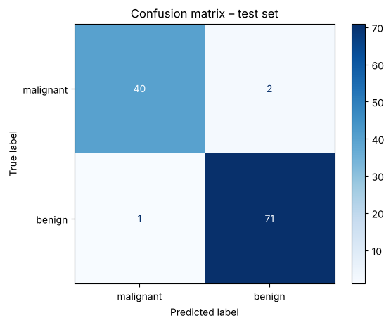

# Breast Cancer Tumor Classifier 🔬

A machine learning project that predicts whether a breast tumor is **malignant** (cancer) or **benign** (not cancer) from measurements of its cells.

The notebook explains **every import and every function** step by step, so it can also be used as a guide to a full scikit-learn workflow.

> ⚠️ This is a learning project. It is not a medical tool.

## Results

| Metric (test set, 114 tumors) | Score |
|---|---|
| Accuracy | **97.4%** |
| Malignant recall (cancers caught) | **95.2%** (40 of 42) |
| Malignant precision | **97.6%** |

Lowering the decision threshold to 10% catches **100%** of the malignant tumors in the test set. The cost is more false alarms (precision drops to 66.7%).





## Dataset

**Breast Cancer Wisconsin (Diagnostic)**, which comes with scikit-learn (`load_breast_cancer`), so no download is needed.
- 569 tumors (212 malignant, 357 benign)
- 30 numerical features describing the cell nuclei in a microscope image: radius, texture, perimeter, area, smoothness, concavity, and more

## What the project does

1. **Explore:** check for missing values, compare the two classes with histograms, find the features most correlated with the label
2. **Split:** stratified 80/20 train/test split
3. **Build pipelines:** `StandardScaler` + a model in one object
4. **Compare 4 models** with 5-fold cross-validation, using accuracy and malignant recall:

   | Model | CV accuracy | CV malignant recall |
   |---|---|---|
   | Logistic Regression | 0.980 | 0.965 |
   | SVC | 0.971 | 0.959 |
   | KNN | 0.967 | 0.941 |
   | Random Forest | 0.954 | 0.929 |

5. **Tune** the best model (Logistic Regression `C`) with `GridSearchCV`
6. **Test:** accuracy, confusion matrix, and classification report
7. **Adjust the threshold** to trade precision for catching more cancers
8. **Explain the model:** find the measurements that push a prediction toward malignant
9. **Save and reload** the model with `joblib` and predict a "new" tumor

## Tools

Python · scikit-learn · pandas · NumPy · Matplotlib · joblib · Jupyter

## How to run

1. Install Python 3.10 or newer
2. Install the libraries:
   ```
   pip install numpy pandas matplotlib scikit-learn joblib jupyter
   ```
3. Open `tumor_classifier.ipynb` in VS Code or Jupyter and click **Run All** (it takes less than a minute)

## Files

```
├── README.md
├── tumor_classifier.ipynb      # the full project with explanations
└── images/
    ├── model_comparison.png
    └── confusion_matrix.png
```

## What I learned

- Why **recall** matters more than accuracy when a missed case is dangerous
- How to build a custom scorer with `make_scorer` (`pos_label=0` for malignant)
- How pipelines keep scaling inside cross-validation, so test data never leaks into training
- How the decision threshold changes the precision/recall trade-off

## Credit

Dataset: W. N. Street, W. H. Wolberg, and O. L. Mangasarian, *Breast Cancer Wisconsin (Diagnostic)*, UCI Machine Learning Repository.
